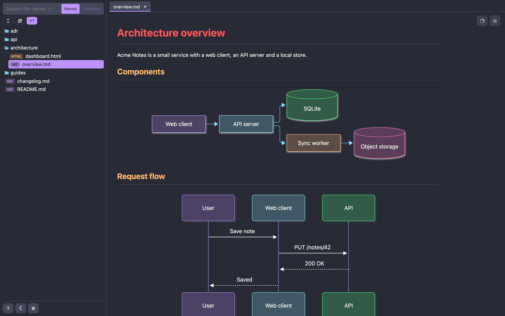
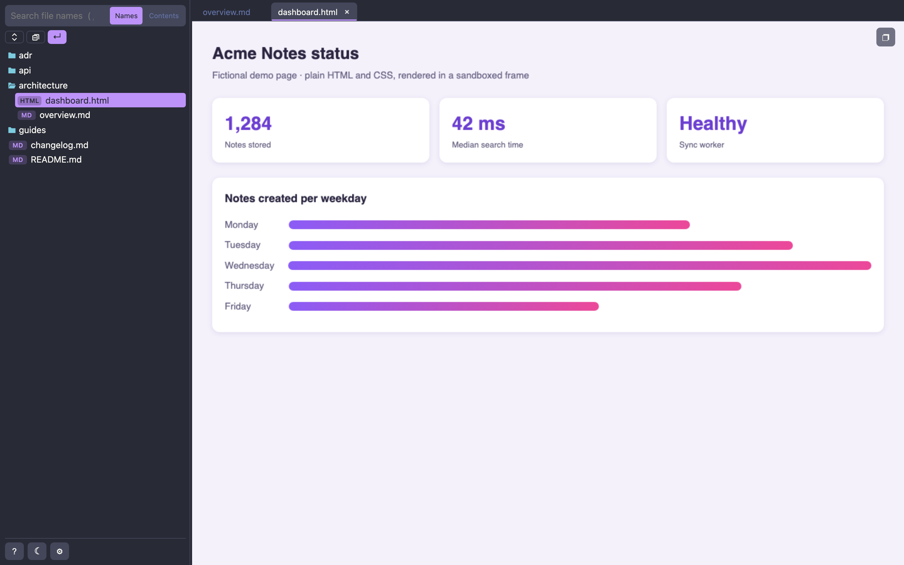

# docs-browser

A zero-config local browser for the documentation in a folder: a file tree on the left, a preview on the
right. It renders Markdown (GitHub flavour), Mermaid diagrams and HTML files, and updates the preview when
a file changes. One static binary, no configuration file, no network access needed.





<sub>Screenshots use the fictional demo docs in `examples/demo-docs`. Light theme: [docs/images/screenshot-light.png](docs/images/screenshot-light.png). Regenerate with `docs-browser examples/demo-docs --port 4790` and `node tests/screenshot.mjs`.</sub>

```bash
docs-browser .            # serve the current folder at http://127.0.0.1:4747 and open it
docs-browser ./docs --port 8080    # the browser opens automatically; add --no-open to keep it closed
docs-browser docs/notes.md  # serves the git repository that holds the file (or its folder) and opens that file
```

## Install

From a checkout of this repository:

```bash
cargo install --locked --path .
```

From GitHub, pinned to a release tag:

```bash
cargo install --locked --git https://github.com/shdennlin/docs-browser --tag v0.4.0
```

`--locked` makes cargo use the committed `Cargo.lock`, which is what pins exact dependency versions.
Supported platforms: macOS and Linux. Windows is not supported.

## Usage

```text
docs-browser [OPTIONS] [DIRECTORY]

  --port <PORT>      TCP port, 0 asks the OS for a free one      [default: 4747, then the next free one]
  --host <HOST>      address to bind: an IP address or localhost [default: 127.0.0.1]
  --no-open          do not open the page in the default browser (it opens by default)
  --include-hidden   make dot-prefixed files and folders visible and readable
  --ignore <NAME>    hide every file or folder with this exact name, at any depth (repeatable; adds to the built-in list: .git, node_modules, dist, build, .cache)
  -v, --verbose      log every request to stderr
  -h, --help         print help
  -V, --version      print the version
```

- Exit codes: `0` normal stop, `1` runtime error such as a port already in use, `2` bad usage or a
  directory that is missing, not a directory, or cannot be read.
- The URL is printed at startup (`Serving <folder> at http://127.0.0.1:4747`). A file argument also prints `Opening <url>`, the page for that file. If 4747 is busy and `--port` was not given, the next free port is used and a `note:` line says so.
- Listed: Markdown (`.md`, `.markdown`), HTML (`.htm`, `.html`), images (`.png`, `.jpg`, `.jpeg`, `.gif`,
  `.webp`, `.avif`), and PDF. Images and PDF are shown directly. A page can also load the CSS, JavaScript, images and fonts next to it.
- `/?file=docs/architecture.md#section` opens a file directly; the address bar always shows the current file.
- Drag the divider between the list and the preview to change the width of the list (keyboard: focus the
  divider, then Left, Right or Home; double click resets it). The width is remembered by the browser.
- Expanded folders are remembered per served folder in the browser, so they open again on the next visit.
- On a loopback address the file information bar has an `Open in VS Code` link (it needs VS Code's `vscode://`
  handler). It is not shown when the server listens on another address.

## Security model

The server is read-only and meant for one person on one machine.

- It binds to `127.0.0.1` by default. `--host 0.0.0.0` works but prints a warning: every visible file is then
  readable by your network, and the `Host` check is off (the `Origin` check stays on).
- Every request path is resolved against the canonical root. `..`, absolute paths, symlinks that leave the
  folder, and case variants such as `Node_Modules` are refused with a plain 404.
- `.git`, `node_modules`, `dist`, `build` and `.cache` are never served. Dot-prefixed files are hidden unless
  you pass `--include-hidden`. File types outside the whitelist (for example `.env`, `.json`, `.txt`) are
  never served.
- HTML files run inside a sandboxed `<iframe>` without `allow-same-origin`, and every `/files/*` response also
  carries `Content-Security-Policy: sandbox`, so a page cannot read your other files through the server.
  Because of that, JavaScript in a previewed page cannot `fetch()` your local files.
- Markdown cannot contain raw HTML, links with schemes other than `http`, `https` and `mailto` are inert,
  and Mermaid runs in strict mode.

The full requirements, decisions and acceptance criteria are in [PRD.md](PRD.md).

## Development

```bash
make help        # list the targets
make test        # Rust tests, vendored-file checksums, frontend unit tests
make build       # release build
python3 tests/suite.py --milestone all   # every acceptance criterion of PRD section 13
```

- `tests/suite.py` prints one `ID | M | status | note` row per criterion. Browser checks drive a headless
  Chrome over the DevTools protocol (`tests/browser.mjs`, no extra packages) and need Chrome installed.
- On macOS, the two `--open` checks would open a real browser tab, so they run only with
  `DOCS_BROWSER_SUITE_OPEN=1`.
- `tests/linux-browser.sh` runs the browser checks against a server built and served inside a Linux container
  (Docker), with Chrome on the host.
- `frontend/vendor/` holds the pinned browser libraries; `tests/check-vendor.sh` verifies their checksums.
- `docs/spikes/` records the measurements behind the design; `docs/benchmark.md` the performance numbers.

## Search, theme and file list

- Type in the box above the file list to filter by file name; switch to `Contents` to search inside the Markdown and HTML files. `/` focuses the box.
- `Expand all` / `Collapse all` open or close every folder; each file carries an `MD` or `HTML` badge.
- In dark mode the page uses the Dracula palette with rainbow headings; light mode is unchanged. The sun/moon button switches between light and dark (remembered); without it the page follows the system.
- Hover a folder for its expand / collapse icons (open or close everything inside it); `Wrap` toggles long names; a floating `☰` outline lists the headings; `⚙` opens the settings. HTML pages fill the right panel.
- Command/Control-click (or middle-click) a file to open it in a new tab; `[` `]` switch tabs, `Alt W` closes one. Shortcuts: `/` or `Cmd/Ctrl K` search, `j` `k` `g` `G` scroll, `o` outline, `d` light/dark, `c` copy the file name, `?` shows the full list.
- Every Mermaid diagram has a `⤢` button that opens it full screen: drag to pan, mouse wheel (or pinch) to zoom, `Fit` or `0` to refit, `Esc` to close.
- A status bar under the preview shows when the file was created and last modified and, inside a git repository, the branch, the file's last commit and whether it has uncommitted changes (git is optional; nothing is shown if it is missing).
