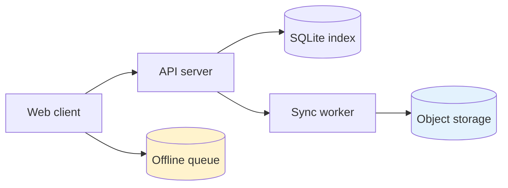
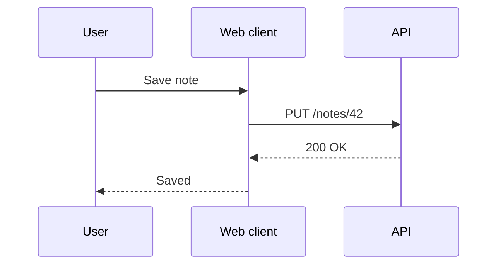
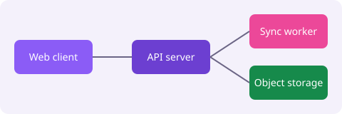

# Architecture overview

Acme Notes is a small service with a web client, an API server and a local store.

## Components

## Request flow

## Design goals

1. Everything works offline.
2. Notes are plain files that survive the app.
3. The API stays small and predictable.

### Trade-offs

- Search runs on the device for encrypted notebooks.
- The sync worker is single-tenant per process.

## Decisions

See [ADR 0001](../adr/0001-use-sqlite.md) for why the index lives in SQLite, and [ADR 0002](../adr/0002-end-to-end-encryption.md) for how note bodies are encrypted.

## Status page

The live status is on the [status dashboard](dashboard.html).
