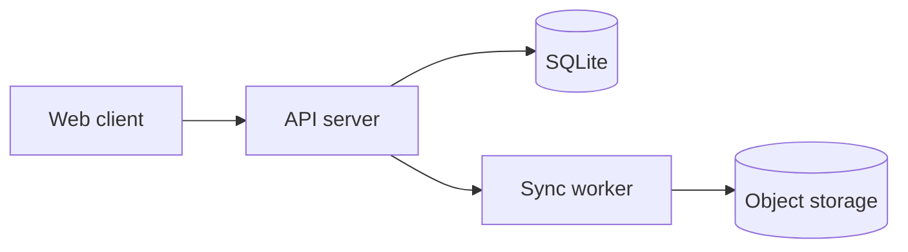
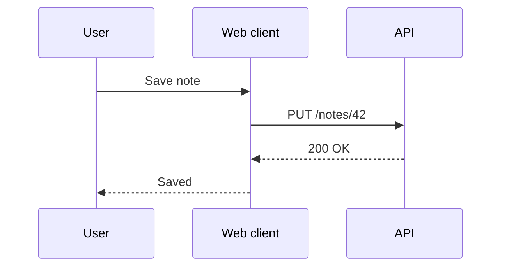

# Architecture overview

Acme Notes is a small service with a web client, an API server and a local store.

## Components

## Request flow

## Design goals

1. Everything works offline.
2. Notes are plain files that survive the app.
3. The API stays small and predictable.

## Decisions

See [ADR 0001](../adr/0001-use-sqlite.md) for why the index lives in SQLite.
